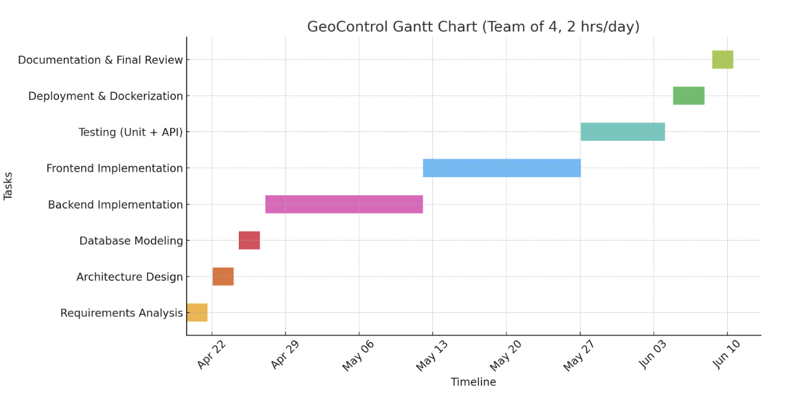

# Project Estimation

Date: 18.04.2025 

Version: v1

# Estimation approach

Consider the GeoControl project as described in the swagger, assume that you are going to develop the project INDEPENDENT of the deadlines of the course, and from scratch

# Estimate by size

###

|                                                                                                         | Estimate |
| ------------------------------------------------------------------------------------------------------- | -------- |
| NC = Estimated number of classes to be developed                                                        |    60    |
| A = Estimated average size per class, in LOC                                                            |    100   |
| S = Estimated size of project, in LOC (= NC \* A)                                                       |   6000   |
| E = Estimated effort, in person hours (here use productivity 10 LOC per person hour)                    |    600   |
| C = Estimated cost, in euro (here use 1 person hour cost = 30 euro)                                     |  18000   |
| Estimated calendar time, in calendar weeks (Assume team of 4 people, 8 hours per day, 5 days per week ) |  240 hours (2 hours per person per day for 5 days a week) -> 6 weeks for code part         |

# Estimate by product decomposition

###

| Component name       | Estimated effort (person hours) |
| -------------------- | ------------------------------- |
| Requirement document |            20                   |
| Design document      |           20                    |
| Code                 | 240 ( 120 backend + 120 frontend) |
| Unit tests           |           35                    |
| API tests            |           35                    |
| Management documents |          10                     |
| Database modeling    |          20                     |

# Estimate by activity decomposition

###

| Activity Name              | Estimated Effort (Person Hours) |
|---------------------------|--------------------------------:|
| Requirements analysis      | 20                             |
| Architecture design        | 20                             |
| Database modeling         | 20                             |
| Backend implementation    | 120                            |
| Frontend implementation   | 120                            |
| Testing (unit + API)      | 70                             |
| Deployment & dockerization| 30                             |
| Documentation & final review | 20                           |

###

# Summary

Report here the results of the three estimation approaches. The estimates may differ. Discuss here the possible reasons for the difference

|                                    | Estimated effort | Estimated duration |
| ---------------------------------- | ---------------- | ------------------ |
| estimate by size                   |      240         |  6 weeks           |
| estimate by product decomposition  |     380          |  9 weeks           |
| estimate by activity decomposition |     420          |  10 weeks          |
