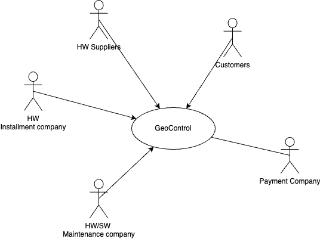
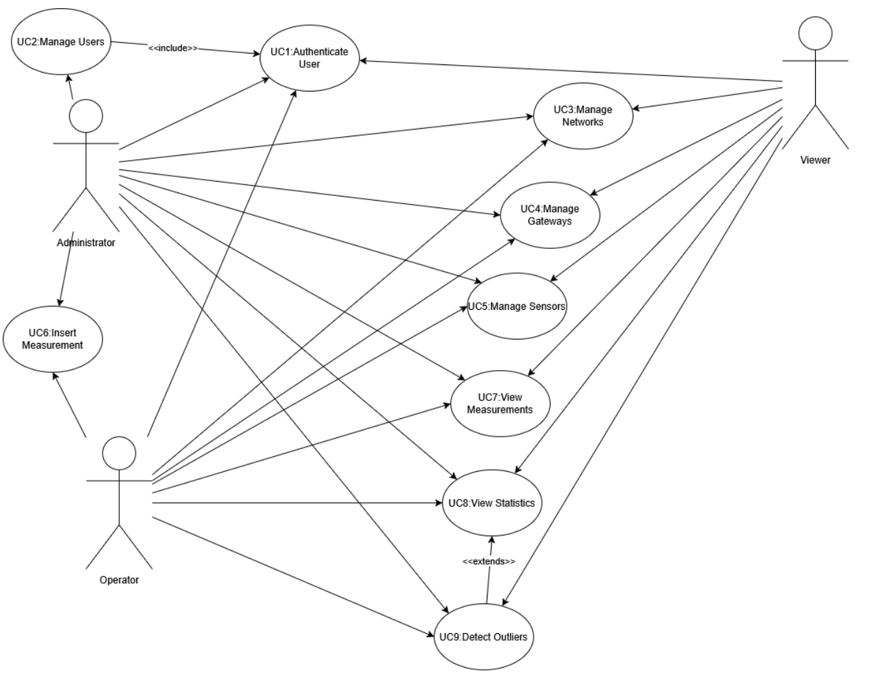
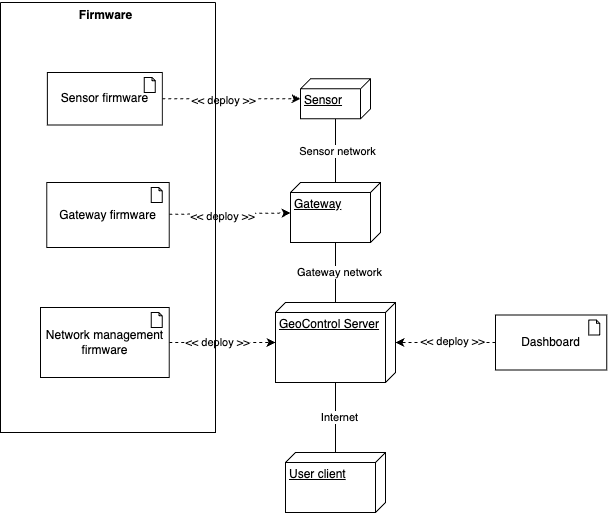

# Requirements Document - GeoControl

Date: 18/04/2025

Version: V1 - description of Geocontrol as described in the swagger

| Version number | Change |
| :------------: | :----: |
|                |        |

# Contents

- [Requirements Document - GeoControl](#requirements-document---geocontrol)
- [Contents](#contents)
- [Informal description](#informal-description)
- [Business Model](#business-model)
- [Stakeholders](#stakeholders)
- [Context Diagram and interfaces](#context-diagram-and-interfaces)
  - [Context Diagram](#context-diagram)
  - [Interfaces](#interfaces)
- [Stories and personas](#stories-and-personas)
- [Functional and non functional requirements](#functional-and-non-functional-requirements)
  - [Functional Requirements](#functional-requirements)
  - [Non Functional Requirements](#non-functional-requirements)
- [Use case diagram and use cases](#use-case-diagram-and-use-cases)
  - [Use case diagram](#use-case-diagram)
    - [Use case 1: Authenticate User](#use-case-1-authenticate-user)
      - [Scenario 1.1: User logs in](#scenario-11-user-logs-in)
    - [Use case 2: Manage Users (Admin Only)](#use-case-2-manage-users-admin-only)
      - [Scenario 2.1: Create User](#scenario-21-create-user)
      - [Scenario 2.2: Retrieve User List](#scenario-22-retrieve-user-list)
      - [Scenario 2.3: Retrieve Specific User](#scenario-23-retrieve-specific-user)
      - [Scenario 2.4: Delete User](#scenario-24-delete-user)
    - [Use case 3: Manage Networks](#use-case-3-manage-networks)
      - [Scenario 3.1: Create Network](#scenario-31-create-network)
      - [Scenario 3.2: Retreive all Networks](#scenario-32-retreive-all-networks)
      - [Scenario 3.3: Retrieve Specific Network](#scenario-33-retrieve-specific-network)
      - [Scenario 3.4: Update Network](#scenario-34-update-network)
      - [Scenario 3.5: Delete Network](#scenario-35-delete-network)
    - [Use case 4: Manage Gateways](#use-case-4-manage-gateways)
      - [Scenario 4.1: Create Gateway](#scenario-41-create-gateway)
      - [Scenario 4.2: Retreive all Gateways](#scenario-42-retreive-all-gateways)
      - [Scenario 4.3: Retrieve Specific Gateway](#scenario-43-retrieve-specific-gateway)
      - [Scenario 4.4: Update Gateway](#scenario-44-update-gateway)
      - [Scenario 4.5: Delete Gateway](#scenario-45-delete-gateway)
    - [Use case 5: Manage Sensors](#use-case-5-manage-sensors)
      - [Scenario 5.1: Create sensor](#scenario-51-create-sensor)
      - [Scenario 5.2: Retreive all sensors](#scenario-52-retreive-all-sensors)
      - [Scenario 5.3: Retrieve Specific sensor](#scenario-53-retrieve-specific-sensor)
      - [Scenario 5.4: Update sensor](#scenario-54-update-sensor)
      - [Scenario 5.5: Delete sensor](#scenario-55-delete-sensor)
    - [Use case 6: Insert Measurements](#use-case-6-insert-measurements)
      - [Scenario 6.1: Insert a measurement](#scenario-61-insert-a-measurement)
    - [Use case 7: View Measurements](#use-case-7-view-measurements)
      - [Scenario 7.1: View measurement by sensor](#scenario-71-view-measurement-by-sensor)
      - [Scenario 7.2: View measurement by network/sensor group](#scenario-72-view-measurement-by-networksensor-group)
    - [Use case 8: View Statistics](#use-case-8-view-statistics)
    - [Use case 9: Detect Outlier measurements](#use-case-9-detect-outlier-measurements)
- [Glossary](#glossary)
- [System Design](#system-design)
- [Deployment Diagram](#deployment-diagram)

# Informal description

GeoControl is a software system designed for monitoring physical and environmental variables in various contexts: from hydrogeological analyses of mountain areas to the surveillance of historical buildings, and even the control of internal parameters (such as temperature or lighting) in residential or working environments.

# Business Model

- **Value Proposition**: **Smart monitoring** of both hydrogeological parameters of large-scale territories and physical parameters of public/private entities. 
 

- **Key Activities**: 
  - **Installment of sensors** in the target environment, together with the Gateway and related control firmware 
  - **Production** of sensors and gateways 
  - **Development** of gateway’s control firmware and user Dashboard for managing their own network 
  - **Automated data collection** and anomaly detection 
 
- **Key Resources**: 
  - **SW Development program licenses**
  - **Storeroom for hardware** (sensors and gateways) 
  - **Hosting infrastructure** 
 
- **Key Partners**:
  - **HW Suppliers** (gateways + sensors) 
  - Companies which develop the SW used by the development team
  - **HW Installment companies**  
  - **HW Maintenance companies** 
  - **Cloud providers** (hosting, scaling) 
 
- **Customer Segments**:
  -  **Regions/districts** who want to monitor their environmental parameters in real-time 
  - **Public/private companies** who want to monitor the company’s parameters 
 
- **Channels**:
  - **GeoControl website**:
    - *Evaluation*: Show off features of GeoControl solution 
    - *Purchase*: Purchasing options (subscription) 
    - *SW Delivery*: Downloading firmware & updates 
    - *After sales*: FAQ page, customer support email, social media account links 
  - **Social media accounts** (*Awareness*) 
  - **Online marketing** (*Awareness*) 
  - **GeoControl HQs** (*HW Delivery*) 
 
- **Customer Relationships**:
  - **Customer support email** to ask questions and get hands-on support on hw maintenance and installment from certified technicians 
  - **Website FAQ page** 
  - **Weekly tips-and-tricks** or “did you know…” emails sent to customers 
  - **GeoControl social media accounts** 
  - **Dedicated technical support** for enterprise clients 
 
- **Cost Structure**: 
  - **HW Installment performance cost** 
  - Cost of **sw development** 
  - Cost of **IDE licenses and general productivity programs** (Office365) 
  - Cost of **buying hw from suppliers** 
  - **Website and servers** (communicating with gateways) maintenance cost 
  - **Online ads**
  - **Social media accounts managing** 
  - **Development team salary** 
 
- **Revenue Streams**:
  - **HW Installment & Upgrading**  
  - **Subscription payments** to use the service  
  - **Maintenance & support** package 
  - HW/SW **enterprise customization**  

# Stakeholders

| Stakeholder name                                | Description                                                              |
|-------------------------------------------------|---------------------------------------------------------------------------|
| Union of Mountain Communities of the Piedmont  | Commissioner                                                              |
| Developer team                                  | Software developers                                                       |
| End users                                       | Admins, operators, viewers                                                |
| Hardware suppliers                              | Companies who provide gateways and sensors                                |
| Customers                                       | Public and private entities                                               |
| Marketing team                                  | Team who runs online ads                                                  |
| Customer support team                           | Team who manages customer relationships                                    |
| Industrial Enterprises                          | Integrate GC’s solution to their business                                  |
| HW Installment company                          | Company who installs hardware (sensors and gateways)                      |
| HW Maintenance company                          | Company who fixes faulty hardware and upgrades existing hardware          |
| Payment company                                 | Company who handles customer payments initiated on the GeoControl website page |

# Context Diagram and interfaces

## Context Diagram

## Interfaces

| Actor                         | Logical Interface                         | Physical Interface                               |
|--------------------------------|-------------------------------------------|-------------------------------------------------|
| Customers                     | Network Control UI                        | Client                                           |
| HW/SW maintenance company     | Administration & System update firmware   | GC’s Servers which connect to gateways           |
| Payment company               | Payment API                               | GC’s Server to Payment company’s Servers         |
| HW Installment company        | Installation software                     | Gateway and sensors                              |
| HW Suppliers                  | None                                      | Gateway and sensors                              |

# Stories and personas

- **Persona 1**
  - **Role**: *Administrator*
  - **Goals**:
    - Create new users with different access levels based on their role, or delete and update existing users 
    - Retrieve the list of all users or a specific user
    - All of Operator’s capabilities 
 
- **Persona 2**
  - **Role**: *Operator*
  - **Goals**:
    - Manage (add/change/remove) networks, gateways and sensors 
    - Manually insert measurements for a sensor 
    - All of Viewer’s capabilities 
 
- **Persona 3**
  - **Role**: *Viewer*
  - **Goals**:
    - Retrieve measurements and statistics for a set of sensors of a specific network or for a specific sensor 
    - Retrieve only the outlier measurements for a set of sensors of a specific network or for a specific sensor 

# Functional and non functional requirements

## Functional Requirements

| ID  | Description |
|-----|-------------|
| **[1] Authentication and Authorization** | |
| **FR1** | The system shall allow users to log in by submitting a valid combination of username and password. |
| **FR2** | Upon successful authentication, the system shall return a JSON Web Token (JWT) that must be included in all subsequent API requests. |
| **FR3** | The system shall enforce role-based access control. Admins have full access; Operators can manage networks and devices but not users; Viewers can only view data. |
| **[2] User Management (Admin Only)** | |
| **FR4** | The system shall allow Admin users to create new user accounts by specifying username, password, and role. |
| **FR5** | The system shall allow Admin users to retrieve a complete list of registered users. |
| **FR6** | The system shall allow Admin users to query and retrieve details for a specific user by username. |
| **FR7** | The system shall allow Admin users to remove an existing user **from** the system by specifying their username. |
| **[3] Network Management** | |
| **FR8** | The system shall allow Admins and Operators to create a new network identified by a unique alphanumeric code and optional name and description. |
| **FR9** | The system shall allow any authenticated user to retrieve a list of all networks available in the system. |
| **FR10** | The system shall allow any authenticated user to query a network by its code and view its information. |
| **FR11** | The system shall allow Admins and Operators to update any field of an existing network, including the unique code. |
| **FR12** | The system shall allow Admins and Operators to delete a network by specifying its code. |
| **[4] Gateway Management** | |
| **FR13** | The system shall allow Admins and Operators to add a gateway (identified by MAC address) to an existing network. |
| **FR14** | The system shall allow any authenticated user to list all gateways associated with a specific network. |
| **FR15** | The system shall allow any authenticated user to view details of a specific gateway using the network code and gateway MAC address. |
| **FR16** | The system shall allow Admins and Operators to update all attributes of a gateway, including its MAC address. |
| **FR17** | The system shall allow Admins and Operators to delete a gateway by specifying the network code and gateway MAC address. |
| **[5] Sensor Management** | |
| **FR18** | The system shall allow Admins and Operators to add a sensor (identified by MAC address) to a specified gateway. |
| **FR19** | The system shall allow any authenticated user to list all sensors connected to a gateway. |
| **FR20** | The system shall allow any authenticated user to retrieve detailed information of a sensor using the network, gateway, and sensor MAC addresses. |
| **FR21** | The system shall allow Admins and Operators to update all attributes of a sensor, including its MAC address. |
| **FR22** | The system shall allow Admins and Operators to delete a sensor by specifying its associated network, gateway, and sensor MAC address. |
| **[6] Measurement Management** | |
| **FR23** | The system shall allow Admins and Operators to insert one or more measurements for a sensor, each including a numeric value and timestamp. |
| **FR24** | The system shall automatically convert all sensor timestamps to ISO 8601 UTC format during storage. |
| **FR25** | The system shall allow any authenticated user to retrieve measurement data for a specific sensor, optionally filtered by date range. |
| **FR26** | The system shall allow any authenticated user to fetch measurements across an entire network, optionally filtered by a list of sensor MAC addresses and a time range. |
| **[7] Statistical Analysis** | |
| **FR27** | The system shall calculate the mean (μ) and variance (σ²) for a given time interval for one or more sensors. |
| **FR28** | The system shall calculate upper and lower thresholds using the formula: upperThreshold = μ + 2σ, lowerThreshold = μ - 2σ. |
| **FR29** | The system shall flag measurement values as outliers if they exceed the upper threshold or fall below the lower threshold. |
| **FR30** | The system shall allow authenticated users to view calculated mean, variance, and threshold values for a specific sensor. |
| **FR31** | The system shall allow authenticated users to request aggregated statistics for several sensors in a network during a given time range. |
| **[8] Outlier Retrieval** | |
| **FR32** | The system shall allow authenticated users to retrieve only the outlier measurements for a particular sensor within a given time range. |
| **FR33** | The system shall allow authenticated users to retrieve only outlier measurements across multiple sensors in a network, optionally filtered by date range and sensor list. |
| **[9] User Profile Management** | |
| **FR34** | The system shall allow users to change their personal information. |

## Non Functional Requirements

| ID   | Type                  | Description | Refers to |
|------|-----------------------|-------------|-----------|
| **[1] Performance Requirements** | | | |
| **NFR1** | Performance           | The system shall support near-real-time processing of sensor measurements sent every 10 minutes from multiple gateways without noticeable delay. | |
| **NFR2** | Performance           | All API endpoints shall return responses within 5 seconds under normal load for standard read operations (e.g., retrieving sensor data). | |
| **NFR3** | Scalability           | The system shall be capable of handling up to 10,000 sensors and millions of measurements per year across multiple networks. | |
| **[2] Availability and Reliability** | | | |
| **NFR4** | Availability          | The system shall maintain an availability of at least 99.9% uptime on a yearly basis, excluding scheduled maintenance. | |
| **NFR5** | Reliability           | The system shall guarantee that no more than six measurements per sensor per year are lost due to processing or transmission failures. | |
| **NFR6** | Data Integrity        | All incoming sensor data must be reliably stored in the database with transactional consistency to prevent data loss during system faults. | |
| **[3] Security Requirements** | | | |
| **NFR7** | Authentication        | The system shall use JWT (JSON Web Tokens) for stateless authentication of all API requests. | |
| **NFR8** | Access Control        | The system shall enforce three levels of access: Admin (full), Operator (device and data management), and Viewer (read-only). | |
| **NFR9** | Data Security         | All HTTP communications between the client and server shall be encrypted using HTTPS. | |
| **NFR10**| Data Protection       | Passwords shall be securely stored using industry-standard hashing algorithms (e.g., bcrypt, PBKDF2). | |
| **[4] Usability Requirements** | | | |
| **NFR11**| API Design            | The web client shall interact with the backend via clearly defined and documented RESTful endpoints. | |
| **NFR12**| Data Formatting       | All date-time values shall be transmitted and stored using ISO 8601 format in UTC, ensuring clarity and interoperability. | |
| **NFR13**| User Experience       | Clients shall be able to convert UTC timestamps to their local timezone as needed. | |
| **[5] Maintainability and Extensibility** | | | |
| **NFR14**| System Architecture   | The system shall follow a modular design for managing networks, gateways, and sensors to allow easy updates or extensions in the future. | |
| **NFR15**| Documentation         | All REST API endpoints shall be described using the OpenAPI Specification (Swagger) to support automated testing and client integration. | |
| **NFR16**| Deployment            | The system shall be containerizable (e.g., via Docker) to support simplified deployment, rollback, and scalability. | |
| **[6] Data Management and Consistency** | | | |
| **NFR17**| Data Integrity        | Create, update, and delete operations on users, networks, gateways, and sensors shall be atomic to avoid partial updates and preserve database integrity. | |
| **NFR18**| Data Validation       | The system shall validate the uniqueness of MAC addresses (for gateways and sensors) and codes (for networks) to prevent duplicates. | |
| **[7] Legal and Regulatory Compliance** | | | |
| **NFR19**| Compliance            | The system shall comply with any applicable data retention policies defined by the commissioning authority or legal regulations. | |
| **NFR20**| Auditability          | All changes to critical entities (users, networks, gateways, sensors, and measurements) shall be traceable through logs or versioning mechanisms to support audits. | |

# Use case diagram and use cases

## Use case diagram

### Use case 1: Authenticate User

| Actors involved       | Administrator, Operator, Viewer |
|-----------------------|----------------------------------|
| Precondition          | User has valid login credentials |
| Postcondition         | User is logged in and receives a JWT token |
| Nominal scenario      | User logs in with credentials and gets redirected to the dashboard |
| Variants              | User enters wrong credentials and retries |
| Exceptions            | Invalid username/password: login fails with error message |

#### Scenario 1.1: User logs in

| Scenario 1.1 |                |
|--------------|----------------|
| Precondition  | User has valid login credentials |
| Postcondition | User is logged in and receives a JWT token |
| Step 1        | User opens login interface  |
| Step 2        | User enters username and password |
| Step 3        | System verifies credentials |
| Step 4        | If valid, system issues JWT token  |
| Step 5        | User is redirected to dashboard  | 

### Use case 2: Manage Users (Admin Only)

| Actors involved       | Administrator |
|-----------------------|----------------------------------|
| Precondition          | Admin is authenticated and authorized |
| Postcondition         | User data is modified (created, retrieved, updated, or deleted)|
| Nominal scenario      | Admin opens user management interface and modifies user data |
| Variants              | None |
| Exceptions            | Duplicate username during creation; User not found during retrieval/deletion |

#### Scenario 2.1: Create User
| Scenario 2.1 |                |
|--------------|----------------|
| Precondition  | Admin is authenticated and authorized |
| Postcondition | User is created |
| Step 1        | Admin opens user management interface |
| Step 2        | Admin inputs new user data |
| Step 3        | System creates user and stores in database |

#### Scenario 2.2: Retrieve User List
| Scenario 2.2 |                |
|--------------|----------------|
| Precondition  | Admin is authenticated and authorized |
| Postcondition | List of users is displayed |
| Step 1        | Admin opens user management interface |
| Step 2        | Admin requests full user list |
| Step 3        | System displays list of users |

#### Scenario 2.3: Retrieve Specific User 
| Scenario 2.3 |                |
|--------------|----------------|
| Precondition  | Admin is authenticated and authorized |
| Postcondition | Specific user data is displayed |
| Step 1        | Admin opens user management interface |
| Step 2        | Admin inputs username  |
| Step 3        | System displays user data |

#### Scenario 2.4: Delete User 
| Scenario 2.4 |                |
|--------------|----------------|
| Precondition  | Admin is authenticated and authorized |
| Postcondition | User is deleted |
| Step 1        | Admin opens user management interface |
| Step 2        | Admin selects user to delete  |
| Step 3        | System removes user from database |

### Use case 3: Manage Networks 

| Actors involved       | Administrator, Operator, Viewer (read-only) |
|-----------------------|----------------------------------|
| Precondition          | User is authenticated |
| Postcondition         | Network is created, updated, deleted, or viewed |
| Nominal scenario      | User is authenticated and successfully modifies network |
| Variants              | None |
| Exceptions            | Invalid network code; Permission denied |

#### Scenario 3.1: Create Network
| Scenario 3.1 |                |
|--------------|----------------|
| Precondition  | User is authenticated |
| Postcondition | Network is created |
| Step 1        | Admin/Operator opens network panel   |
| Step 2        | Enters network code, name, description  |
| Step 3        | System registers network  |

#### Scenario 3.2: Retreive all Networks
| Scenario 3.2 |                |
|--------------|----------------|
| Precondition  | User is authenticated |
| Postcondition | List of networks is displayed |
| Step 1        | User requests list of networks   |
| Step 2        | System returns all networks   |

#### Scenario 3.3: Retrieve Specific Network
| Scenario 3.3 |                |
|--------------|----------------|
| Precondition  | User is authenticated |
| Postcondition | The requested network is displayed |
| Step 1        | User provides network code    |
| Step 2        | System shows network details   |

#### Scenario 3.4: Update Network 
| Scenario 3.4 |                |
|--------------|----------------|
| Precondition  | User is authenticated |
| Postcondition | The network gets updated |
| Step 1        | User (Admin/Operator) selects network  |
| Step 2        | User makes changes    |
| Step 3        | System updates network     |

#### Scenario 3.5: Delete Network 
| Scenario 3.5 |                |
|--------------|----------------|
| Precondition  | User is authenticated |
| Postcondition | The network gets deleted |
| Step 1        | User (Admin/Operator) selects network  |
| Step 2        | System deletes it    |

### Use case 4: Manage Gateways 

| Actors involved       | Administrator, Operator, Viewer (read-only) |
|-----------------------|----------------------------------|
| Precondition          | User is authenticated |
| Postcondition         | Gateway data is modified or displayed |
| Nominal scenario      | xxx |
| Variants              | None |
| Exceptions            | Invalid gateway MAC Address; Permission denied |

#### Scenario 4.1: Create Gateway
| Scenario 4.1 |                |
|--------------|----------------|
| Precondition  | User is authenticated |
| Postcondition | Gateway is created |
| Step 1        | Admin/Operator opens network panel   |
| Step 2        | Enters Gateway name and description  |
| Step 3        | System assigns unique MAC Address to gateway |
| Step 4        | System registers Gateway  |

#### Scenario 4.2: Retreive all Gateways
| Scenario 4.2 |                |
|--------------|----------------|
| Precondition  | User is authenticated |
| Postcondition | List of Gateways is displayed |
| Step 1        | User requests list of gateways   |
| Step 2        | System returns all gateways   |

#### Scenario 4.3: Retrieve Specific Gateway
| Scenario 4.3 |                |
|--------------|----------------|
| Precondition  | User is authenticated |
| Postcondition | The requested gateway is displayed |
| Step 1        | User provides gateway MAC Address |
| Step 2        | System shows gateway details |

#### Scenario 4.4: Update Gateway 
| Scenario 4.4 |                |
|--------------|----------------|
| Precondition  | User is authenticated |
| Postcondition | The Gateway gets updated |
| Step 1        | User (Admin/Operator) selects gateway  |
| Step 2        | User makes changes    |
| Step 3        | System updates gateway     |

#### Scenario 4.5: Delete Gateway 
| Scenario 4.5 |                |
|--------------|----------------|
| Precondition  | User is authenticated |
| Postcondition | The Gateway gets deleted |
| Step 1        | User (Admin/Operator) selects gateway  |
| Step 2        | System deletes it    |

### Use case 5: Manage Sensors 

| Actors involved       | Administrator, Operator, Viewer (read-only) |
|-----------------------|----------------------------------|
| Precondition          | User is authenticated |
| Postcondition         | Sensor data is modified or displayed |
| Nominal scenario      | xxx |
| Variants              | None |
| Exceptions            | Invalid sensor MAC Address; Permission denied |

#### Scenario 5.1: Create sensor
| Scenario 5.1 |                |
|--------------|----------------|
| Precondition  | User is authenticated |
| Postcondition | Sensor is created |
| Step 1        | Admin/Operator opens network panel   |
| Step 2        | Enters sensor name and description  |
| Step 3        | System assigns unique MAC Address to sensor |
| Step 4        | System registers sensor  |

#### Scenario 5.2: Retreive all sensors
| Scenario 5.2 |                |
|--------------|----------------|
| Precondition  | User is authenticated |
| Postcondition | List of sensors is displayed |
| Step 1        | User requests list of sensors   |
| Step 2        | System returns all sensors   |

#### Scenario 5.3: Retrieve Specific sensor
| Scenario 5.3 |                |
|--------------|----------------|
| Precondition  | User is authenticated |
| Postcondition | The requested sensor is displayed |
| Step 1        | User provides sensor MAC Address |
| Step 2        | System shows sensor details |

#### Scenario 5.4: Update sensor 
| Scenario 5.4 |                |
|--------------|----------------|
| Precondition  | User is authenticated |
| Postcondition | The sensor gets updated |
| Step 1        | User (Admin/Operator) selects sensor  |
| Step 2        | User makes changes    |
| Step 3        | System updates sensor     |

#### Scenario 5.5: Delete sensor 
| Scenario 5.5 |                |
|--------------|----------------|
| Precondition  | User is authenticated |
| Postcondition | The sensor gets deleted |
| Step 1        | User (Admin/Operator) selects sensor  |
| Step 2        | System deletes it    |

### Use case 6: Insert Measurements

| Actors involved       | Administrator, Operator |
|-----------------------|----------------------------------|
| Precondition          | Sensor and gateway exist and are active, User is authenticated |
| Postcondition         | Measurement stored in UTC format |
| Nominal scenario      | User (Admin/Operator) correctly inserts sensor measurements |
| Variants              | None |
| Exceptions            | Invalid sensor ID; Invalid Time Stamps |

#### Scenario 6.1: Insert a measurement
| Scenario 6.1 |                |
|--------------|----------------|
| Precondition  | Sensor and gateway exist and are active, User is authenticated |
| Postcondition | Measurement stored in UTC format |
| Step 1        | User (Admin/Operator) selects sensor   |
| Step 2        | Enters measurement value and local timestamp  |
| Step 3        | System converts timestamp to UTC  |
| Step 4        | System stores measurement   |

### Use case 7: View Measurements

| Actors involved       | Administrator, Operator, Viewer |
|-----------------------|----------------------------------|
| Precondition          | User is authenticated |
| Postcondition         | Measurement is displayed |
| Nominal scenario      | User requests measurements and they get displayed correctly |
| Variants              | None |
| Exceptions            | No measurements found |

#### Scenario 7.1: View measurement by sensor
| Scenario 7.1 |                |
|--------------|----------------|
| Precondition          | User is authenticated |
| Postcondition         | Measurement is displayed |
| Step 1                | User specifies sensor ID |
| Step 2                | User requests list of measurements of the sensor |
| Step 3                | System displays measurement  |

#### Scenario 7.2: View measurement by network/sensor group
| Scenario 7.2 |                |
|--------------|----------------|
| Precondition          | User is authenticated |
| Postcondition         | Measurement is displayed |
| Step 1                | User specifies Network/Sensor group ID |
| Step 2                | User requests list of measurements of group |
| Step 3                | System displays group measurements |

### Use case 8: View Statistics

| Actors involved       | Administrator, Operator, Viewer |
|-----------------------|----------------------------------|
| Precondition          | User is authenticated |
| Postcondition         | Stats are computed and displayed |
| Nominal scenario      | User selects sensors and time range, the system computes statistics, and then displays them |
| Variants              | None |
| Exceptions            | No data exists |

### Use case 9: Detect Outlier measurements

| Actors involved       | Administrator, Operator, Viewer |
|-----------------------|----------------------------------|
| Precondition          | Statistical thresholds are computed  |
| Postcondition         | Outlier measurements are retrieved and flagged |
| Nominal scenario      | User requests outliers for sensor/network, system compares each value against thresholds and returns only flagged measurements |
| Variants              | None |
| Exceptions            | No measurements found |

# Glossary
| Term                     | Description | 
|--------------------------|-------------| 
| **Network**              | A logical entity that groups multiple gateways |
| **Gateway**              | A physical device that collects data from connected sensors via serial interface and sends it to the GeoControl system through a network connection |
| **Sensor**               | A physical device that measures the physical quantity (temperature, inclination, etc.) every 10 minutes and transmits the data to the gateway |
| **Dashboard**            | Software deployed on GeoControl servers which allows users (admins, operators and viewers) to manage their network |
| **Firmware**             | Software embedded in gateways and sensors that enables them to function |
| **Admin**                | A user with administrative privileges, with full access to all system functionalities |
| **Operator**             | A user with permissions to manage networks, gateways, and sensors, but with no access to user-related functionalities |
| **Viewer**               | A user with read-only access to networks, gateways, sensors and measurements |
| **Hosting infrastructure** | Hardware infrastructure provided by an external company to aid in building a company's own infrastructure |
| **Payment**              | Exchange of money between two parties |
| **Cloud providers**       | Providers of cloud services used to host and scale the GeoControl infrastructure |
| **Customer support email** | The official email address used to provide technical support to end users |
| **Subscription**         | The usage plan of the GeoControl system, gained through periodical payment |
| **FAQ page**             | A frequently asked questions page (on the website) that provides quick answers to common user queries |
| **Enterprise customization** | Customizing website according to enterprise customers' special needs |
| **Public and private entities** | Organizations, both public (regional authorities) and private (companies), that use GeoControl for environmental monitoring |
| **Industrial enterprise** | Real-world companies or organizations that specialize in monitoring air quality, water levels, pollution etc. Additionally, industrial IOT companies and companies that develop urban-scale monitoring systems (air, noise, crowd, energy, traffic) |
| **User role**            | The access level of a user in the system (admin, operator, viewer) |
| **User capabilities**    | The actions a user can perform in the system, defined by their assigned role |
| **Sensor measurements**  | Data collected periodically by the sensors |
| **HW**                   | Hardware |
| **SW**                   | Software |
| **GC**                   | GeoControl |        

# System Design

 << TODO: >>

# Deployment Diagram

