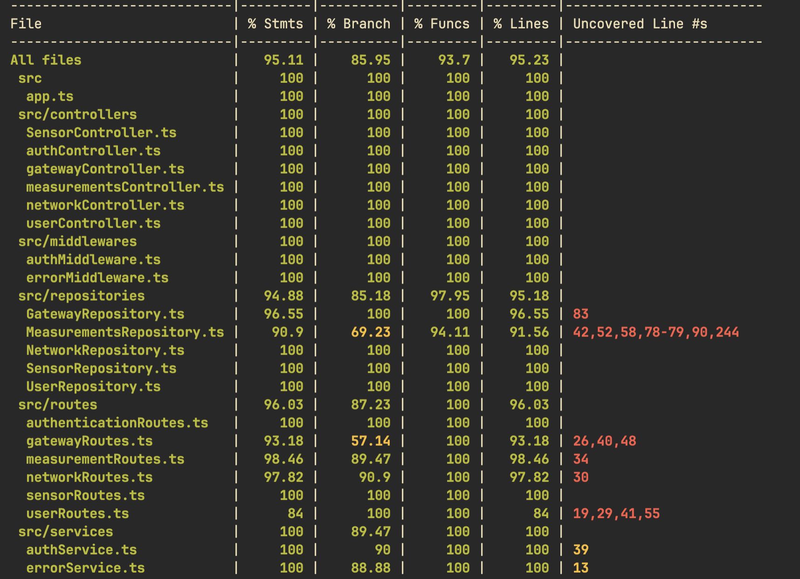
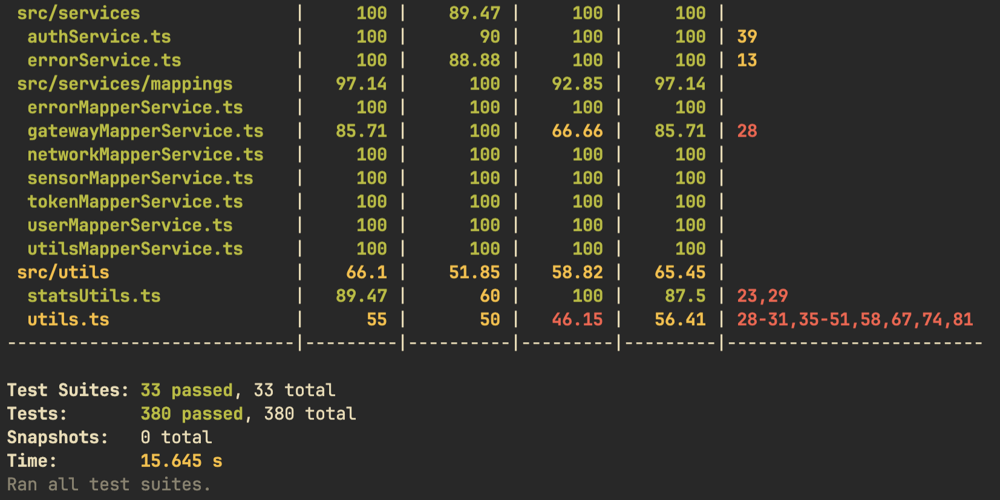

# Test Report

<The goal of this document is to explain how the application was tested, detailing how the test cases were defined and what they cover>

# Contents

- [Test Report](#test-report)
- [Contents](#contents)
- [Dependency graph](#dependency-graph)
- [Integration approach](#integration-approach)
- [Tests](#tests)
- [Coverage](#coverage)
  - [Coverage of FR](#coverage-of-fr)
  - [Coverage white box](#coverage-white-box)

# Dependency graph

<Insert here the dependency graph of GeoControl, showing relationships between controllers, services, repositories, and routes.>

# Integration approach

<The integration approach followed a mixed (bottom-up and top-down) strategy:>
- Step 1: Unit testing of core services and repositories (e.g., MeasurementsRepository, ErrorService)
- Step 2: Unit testing of controllers
- Step 3: Integration testing of route handlers with mocked dependencies
- Step 4: End-to-end (e2e) testing of API endpoints simulating real user flows

# Tests

| Test case name | Object(s) tested | Test level | Technique used |
|---------------|------------------|------------|---------------|
| should generate a valid JWT token | authService.generateToken | Unit | White box |
| should process valid token with correct role | authService.processToken | Unit | White box |
| should throw UnauthorizedError when token is missing | authService.processToken | Unit | White box |
| should throw UnauthorizedError when token format is invalid | authService.processToken | Unit | White box |
| should throw UnauthorizedError when user not found | authService.processToken | Unit | White box |
| should throw InsufficientRightsError when user role is not allowed | authService.processToken | Unit | White box |
| should handle AppError instances | createAppError | Unit | White box |
| should handle errors with status property | createAppError | Unit | White box |
| should handle generic errors | createAppError | Unit | White box |
| should handle undefined errors | createAppError | Unit | White box |
| should log error stack trace when available | createAppError | Unit | White box |
| should create error DTO with all properties | createErrorDTO | Unit | White box |
| should create error DTO with only code | createErrorDTO | Unit | White box |
| should create error DTO with code and message | createErrorDTO | Unit | White box |
| should remove null attributes | createErrorDTO | Unit | White box |
| should map UserDAO to UserDTO | mapUserDAOToDTO | Unit | White box |
| should handle different user types | mapUserDAOToDTO | Unit | White box |
| store measurement for sensor | MeasurementsRepository.storeMeasurementForSensor | Unit | White box |
| retrieve measurements for sensor | MeasurementsRepository.getMeasurementsFromSensor | Unit | White box |
| retrieve stats for sensor | MeasurementsRepository.getStatsFromSensor | Unit | White box |
| retrieve outliers for sensor | MeasurementsRepository.getOutliersFromSensor | Unit | White box |
| retrieve measurements for sensors in network | MeasurementsRepository.getMeasurementsFromSensorsInNetwork | Unit | White box |
| retrieve stats for sensors in network | MeasurementsRepository.getStatsFromSensorsInNetwork | Unit | White box |
| retrieve outliers for sensors in network | MeasurementsRepository.getOutliersFromSensorsInNetwork | Unit | White box |
| should return all networks | networkController.getAllNetworks | Unit | White box |
| should throw 500 on error | networkController.getAllNetworks | Unit | White box |
| should return a specific network | networkController.getNetwork | Unit | White box |
| should throw 404 when network not found | networkController.getNetwork | Unit | White box |
| should throw 500 on other errors | networkController.getNetwork | Unit | White box |
| should create a network | networkController.createNetwork | Unit | White box |
| should throw 400 when code is missing | networkController.createNetwork | Unit | White box |
| should throw 409 when network exists | networkController.createNetwork | Unit | White box |
| should throw 500 on other errors | networkController.createNetwork | Unit | White box |
| should update a network | networkController.updateNetwork | Unit | White box |
| should throw 404 when network not found | networkController.updateNetwork | Unit | White box |
| should throw 409 when network code exists | networkController.updateNetwork | Unit | White box |
| should throw 500 on other errors | networkController.updateNetwork | Unit | White box |
| should delete a network | networkController.deleteNetwork | Unit | White box |
| should throw 404 when network not found | networkController.deleteNetwork | Unit | White box |
| should throw 500 on other errors | networkController.deleteNetwork | Unit | White box |
<!-- Add all other it() blocks from all test/unit/ and test/integration/ files in the same format -->

# Coverage

## Coverage of FR

| Functional Requirement or scenario | Test(s) (examples) |
| :--------------------------------:| :----------------: |
| FR1 Authentication | authenticationRoutes.e2e.test.ts, authService.test.ts |
| FR1.1 Authenticate user | authenticationRoutes.e2e.test.ts, authService.test.ts |
| FR2 Manage users | userRoutes.integration.test.ts, users.e2e.test.ts |
| FR2.1 Retrieve all users | userRoutes.integration.test.ts, users.e2e.test.ts |
| FR2.2 Create a new user | userRoutes.integration.test.ts, users.e2e.test.ts |
| FR2.3 Retrieve a specific user | userRoutes.integration.test.ts, users.e2e.test.ts |
| FR2.4 Delete a specific user | userRoutes.integration.test.ts, users.e2e.test.ts |
| FR3 Manage networks | networkRoutes.integration.test.ts, networks.e2e.test.ts |
| FR3.1 Retrieve all networks | networkRoutes.integration.test.ts, networks.e2e.test.ts |
| FR3.2 Create a new network | networkRoutes.integration.test.ts, networks.e2e.test.ts |
| FR3.3 Retrieve a specific network | networkRoutes.integration.test.ts, networks.e2e.test.ts |
| FR3.4 Update a network | networkRoutes.integration.test.ts, networks.e2e.test.ts |
| FR3.5 Delete a specific network | networkRoutes.integration.test.ts, networks.e2e.test.ts |
| FR4 Manage gateways | gatewayRoutes.integration.test.ts, gateways.e2e.test.ts |
| FR4.1 Retrieve all gateways of a network | gatewayRoutes.integration.test.ts, gateways.e2e.test.ts |
| FR4.2 Create a new gateway for a network | gatewayRoutes.integration.test.ts, gateways.e2e.test.ts |
| FR4.3 Retrieve a specific gateway | gatewayRoutes.integration.test.ts, gateways.e2e.test.ts |
| FR4.4 Update a gateway | gatewayRoutes.integration.test.ts, gateways.e2e.test.ts |
| FR4.5 Delete a specific gateway | gatewayRoutes.integration.test.ts, gateways.e2e.test.ts |
| FR5 Manage sensors | sensorRoutes.integration.test.ts, sensors.e2e.test.ts |
| FR5.1 Retrieve all sensors of a gateway | sensorRoutes.integration.test.ts, sensors.e2e.test.ts |
| FR5.2 Create a new sensor for a gateway | sensorRoutes.integration.test.ts, sensors.e2e.test.ts |
| FR5.3 Retrieve a specific sensor | sensorRoutes.integration.test.ts, sensors.e2e.test.ts |
| FR5.4 Update a sensor | sensorRoutes.integration.test.ts, sensors.e2e.test.ts |
| FR5.5 Delete a specific sensor | sensorRoutes.integration.test.ts, sensors.e2e.test.ts |
| FR6 Manage measurements | measurementRoutes.integration.test.ts |
| FR6.1 Retrieve measurements for a set of sensors of a specific network | measurementRoutes.integration.test.ts |
| FR6.2 Retrieve statistics for a set of sensors of a specific network | measurementRoutes.integration.test.ts, MeasurementsRepository.mock.test.ts |
| FR6.3 Retrieve outliers for a set of sensors of a specific network | measurementRoutes.integration.test.ts, MeasurementsRepository.mock.test.ts |
| FR6.4 Store measurements for a specific sensor | measurementRoutes.integration.test.ts |
| FR6.5 Retrieve measurements for a specific sensor | measurementRoutes.integration.test.ts |
| FR6.6 Retrieve statistics for a specific sensor | measurementRoutes.integration.test.ts, MeasurementsRepository.mock.test.ts |
| FR6.7 Retrieve outliers for a specific sensor | measurementRoutes.integration.test.ts, MeasurementsRepository.mock.test.ts |

## Coverage white box

<Insert here the screenshot of coverage values obtained with jest --coverage>

